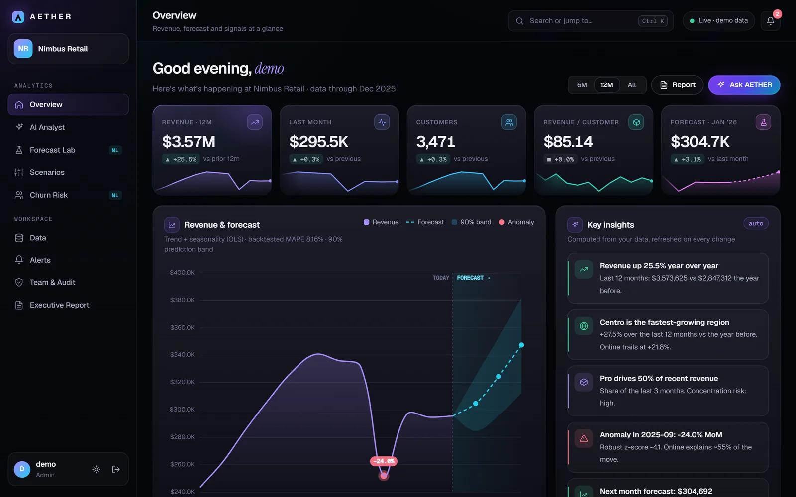
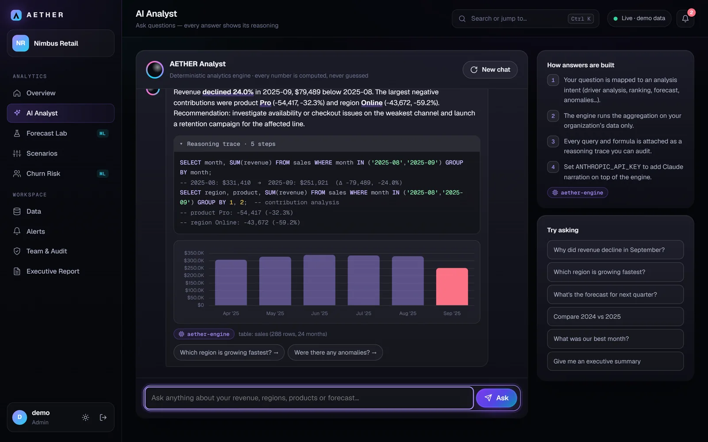
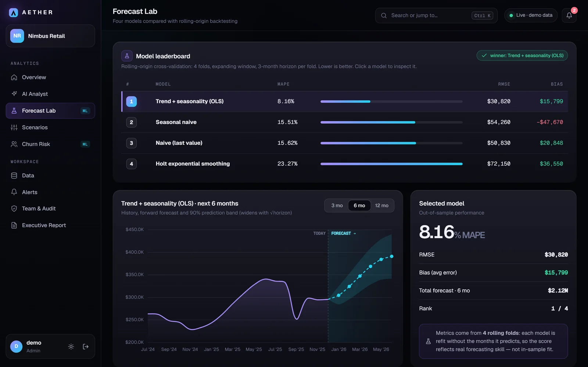
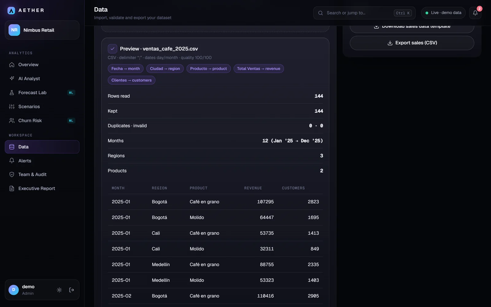
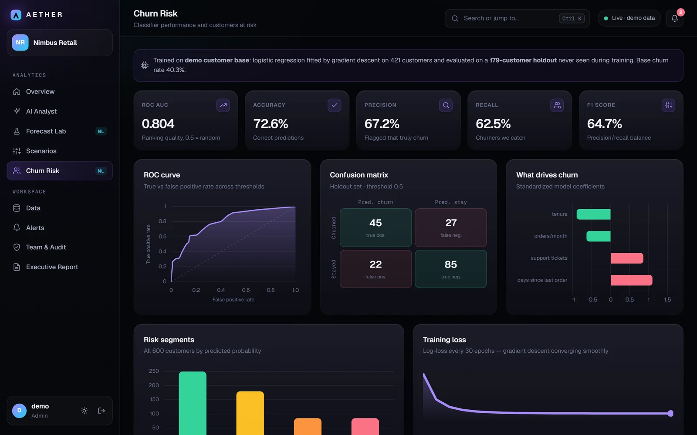

# AETHER

Plataforma de inteligencia de negocios que convierte datos de ventas en pronósticos, alertas y explicaciones verificables. Cada cifra que muestra, incluidas las respuestas del analista de IA, viene acompañada de la consulta o la fórmula que la produjo.

[](https://github.com/saracastrillons/aether/actions/workflows/ci.yml)



## Descripción

Los dashboards de ventas suelen mostrar qué pasó, pero casi nunca por qué. Si los ingresos caen un 24 % en septiembre, alguien tiene que abrir una hoja de cálculo y desglosar región por región hasta encontrar la causa. AETHER automatiza ese trabajo: detecta el mes atípico, calcula qué región y qué producto explican la caída y lo muestra con las consultas SQL que respaldan el resultado.

La idea que guía el proyecto es que un número sin explicación no sirve para tomar decisiones. Por eso el analista de IA no tiene permitido inventar cifras: los cálculos los hace un motor determinista escrito en NumPy, y el modelo de lenguaje, cuando está activo, solo decide qué análisis ejecutar y redacta la respuesta a partir de los resultados.

Está construido con FastAPI y SQLAlchemy en el backend y una SPA en JavaScript sin frameworks ni paso de compilación en el frontend.

**Probarlo:** en la página de inicio, el botón *Launch live demo* entra a una empresa ficticia (Nimbus Retail) con 24 meses de datos. También se puede iniciar sesión como `demo`, `analyst` o `viewer` (la contraseña es igual al usuario) para ver cómo cambian los permisos según el rol.

## Funcionalidades

**Análisis**

- Panel principal con KPIs, pronóstico a tres meses con banda de confianza del 90 %, anomalías marcadas sobre la gráfica, insights generados a partir de los datos, mapa de calor por región y mezcla de productos.
- Analista de IA que responde preguntas en lenguaje natural, en español o inglés: por qué cambió un mes, qué región crece más rápido, cuál fue el mejor mes, comparaciones entre años, pronósticos. Cada respuesta incluye su traza de razonamiento.
- Forecast Lab: cuatro modelos de pronóstico compiten mediante validación cruzada con origen móvil, y el panel principal usa el ganador.
- Simulador de escenarios: precio, inversión en marketing, churn y elasticidad, con un gráfico de puente que separa el efecto de cada variable.
- Riesgo de churn con regresión logística entrenada sobre los clientes de cada organización, métricas en un conjunto de prueba, coeficientes interpretables y una acción sugerida por cliente.

**Datos**

- Importación de CSV o Excel con encabezados en español o inglés (`Fecha`, `Ciudad`, `Ventas`...), cualquier separador, fechas como `14/03/2025` o `mar-25` y montos como `1.234,50` o `$1,234.50`. Si el archivo trae ventas diarias, se agrupan por mes.
- Vista previa antes de guardar: muestra cómo se interpretó cada columna, cuántas filas se descartaron y por qué.
- Exportación a CSV y plantillas descargables.

**Plataforma**

- Organizaciones aisladas entre sí, con roles de administrador, analista y lector aplicados por la API.
- Invitaciones con enlace de un solo uso, registro de auditoría y gestión de la cuenta.
- Alertas sobre KPIs, centro de notificaciones y un reporte ejecutivo listo para imprimir o guardar en PDF.
- Paleta de comandos (`Ctrl K`), modo claro y oscuro, y diseño adaptable a móvil.

<table>
  <tr>
    <td></td>
    <td></td>
  </tr>
  <tr>
    <td align="center">Analista con la traza de razonamiento abierta</td>
    <td align="center">Forecast Lab</td>
  </tr>
  <tr>
    <td></td>
    <td></td>
  </tr>
  <tr>
    <td align="center">Vista previa de un CSV con formato colombiano</td>
    <td align="center">Modelo de churn</td>
  </tr>
</table>

## Los modelos

### Pronóstico

Se comparan cuatro modelos sobre la serie mensual de ingresos:

- Tendencia lineal con estacionalidad anual (términos de Fourier), ajustada por mínimos cuadrados.
- Suavizado exponencial de Holt, con sus parámetros elegidos por búsqueda en rejilla.
- Ingenuo estacional (el mismo mes del año anterior).
- Ingenuo (el último valor).

La evaluación usa validación cruzada con origen móvil: cada modelo se reentrena sin los meses que debe predecir y se mide su error en los tres meses siguientes, en cuatro particiones. Así las métricas reflejan la capacidad real de pronosticar y no el ajuste sobre datos ya vistos. Resultados con los datos de la demo:

| Modelo | MAPE | RMSE |
|---|---|---|
| Tendencia + estacionalidad (MCO) | 8,16 % | $30.820 |
| Ingenuo estacional | 15,51 % | $54.260 |
| Ingenuo | 15,62 % | $50.830 |
| Holt | 23,27 % | $72.150 |

El modelo de tendencia se mantiene por defecto porque es el más fácil de explicar, y solo se reemplaza si otro lo supera por más de un 15 % en MAPE. La banda de predicción se ensancha con la raíz cuadrada del horizonte.

### Anomalías

Se calcula el crecimiento mes a mes y se marcan los meses cuyo puntaje z robusto (mediana y desviación absoluta mediana, en lugar de media y desviación estándar) supera 3,5. Usar la mediana evita que la propia anomalía distorsione el umbral. Si el mismo salto se repite en el mismo mes del año anterior, se considera estacionalidad y no se marca: un diciembre fuerte todos los años no es una anomalía. Para cada mes marcado se identifica la región que explica la mayor parte del cambio.

### Churn

Regresión logística entrenada con descenso de gradiente y una regularización L2 leve, sobre cuatro variables: antigüedad, pedidos por mes, tickets de soporte y días desde la última compra. Se reserva un 30 % estratificado como conjunto de prueba. En la demo, que usa una base sintética de 600 clientes, los resultados son:

| AUC | Exactitud | Precisión | Recall | F1 |
|---|---|---|---|---|
| 0,804 | 72,6 % | 67,2 % | 62,5 % | 64,7 % |

Cuando una organización importa sus propios clientes, el modelo se entrena con ellos y solo puntúa a los clientes activos. Para cada uno se indica qué variable empuja más su riesgo y una acción concreta.

## El analista de IA

Tiene dos modos de funcionamiento con la misma garantía: ninguna cifra la genera un modelo de lenguaje.

Con una clave de la API de Anthropic, Claude actúa como agente con siete herramientas: resumen de KPIs, agregación de ventas con filtros, explicación de un cambio, pronóstico, anomalías, simulación de escenarios y riesgo de churn. Claude decide qué herramientas llamar y redacta la respuesta a partir de lo que devuelven, y cada llamada queda registrada en la traza. Recuerda el contexto de la conversación, así que preguntas como "¿y en noviembre?" funcionan.

Sin clave, o si la API falla, responde un motor de intenciones determinista que cubre los casos más comunes. La aplicación nunca se queda sin analista.

Hay un límite de 40 preguntas por usuario por hora para controlar el costo de la API.

## Arquitectura

```
main.py          API de análisis y caché del contexto analítico por organización
analytics.py     Motor en NumPy: modelos de pronóstico, backtesting, anomalías, churn e insights
assistant.py     Analista: agente con herramientas (Claude) y motor determinista de respaldo
ingest.py        Lectura tolerante de CSV y Excel: sinónimos de columnas, fechas y formatos numéricos
orgs.py          Registro, inicio de sesión, invitaciones, miembros y cuenta
security.py      Hash PBKDF2, JWT HS256, roles y límites de solicitudes
db.py            Modelos de SQLAlchemy 2.0 (SQLite por defecto, PostgreSQL con DATABASE_URL)
static/          SPA en JavaScript, CSS y Chart.js, sin paso de compilación
tests/           Pruebas con pytest
```

Algunas decisiones:

- **Multi-tenencia desde el token.** La organización viene del JWT firmado y cada consulta se filtra por ella. Un usuario no puede pedir datos de otra organización aunque manipule la petición.
- **Caché por organización.** El contexto analítico (agregaciones, modelos, anomalías) se calcula una vez y se invalida cuando cambian los datos, para que la navegación sea instantánea.
- **Sin dependencias pesadas en el análisis.** Los modelos están escritos directamente en NumPy en lugar de usar scikit-learn o statsmodels, lo que mantiene el motor pequeño y fácil de leer de principio a fin.

## Seguridad

- Contraseñas con PBKDF2-SHA256 (200.000 iteraciones) y comparaciones en tiempo constante.
- Tokens con expiración de 8 horas que se renuevan mientras la sesión está activa.
- Roles verificados en el servidor. La interfaz oculta lo que un rol no puede hacer, pero la API lo bloquea igualmente.
- Límites de intentos de inicio de sesión por IP y usuario, para que nadie pueda bloquear la cuenta de otra persona, más un límite de registros por IP.
- La demo pública está protegida: no se pueden cambiar contraseñas, eliminar miembros, importar datos ni editar alertas en ella.
- Encabezados de seguridad HTTP y escape de todo el contenido generado por usuarios en la interfaz.

## Ejecutar localmente

Requiere Python 3.12 o superior.

```bash
python -m venv .venv
.venv\Scripts\activate          # en macOS o Linux: source .venv/bin/activate
pip install -r requirements-dev.txt
```

La aplicación necesita una clave secreta de al menos 48 caracteres para firmar los tokens:

```powershell
# PowerShell
$env:AETHER_SECRET = python -c "import secrets; print(secrets.token_urlsafe(48))"
uvicorn main:app --reload
```

```bash
# bash
export AETHER_SECRET=$(python -c "import secrets; print(secrets.token_urlsafe(48))")
uvicorn main:app --reload
```

La aplicación queda en http://localhost:8000 y la documentación de la API en http://localhost:8000/docs.

Para activar el agente con Claude, hay que definir también `ANTHROPIC_API_KEY` antes de iniciar el servidor.

**Con Docker** (API y PostgreSQL):

```bash
export AETHER_SECRET=...
docker compose up --build
```

## Pruebas

```bash
pytest -q
```

La suite tiene 43 pruebas: autenticación, roles, aislamiento entre organizaciones, importación con formatos en español y Excel, el ciclo del agente con un cliente de Claude simulado, el respaldo cuando la API falla, los límites de solicitudes, la detección de anomalías estacionales y las métricas del churn. Se ejecutan en GitHub Actions con cada push.

## Formato de los datos

Para ventas basta con una columna de fecha y una de ingresos. Región, producto y clientes son opcionales:

```csv
month,region,product,revenue,customers
2025-01,Norte,Pro,27400,322
```

Para el modelo de churn, un archivo con una fila por cliente:

```csv
customer_id,tenure_months,orders_per_month,support_tickets,days_since_last_order,churned
C-0001,24,6,0,5,no
```

Ambas plantillas se pueden descargar desde la sección *Data* de la aplicación.

## Limitaciones y siguientes pasos

- Los límites de solicitudes y la caché viven en memoria, así que funcionan con un solo proceso. Para escalar a varias instancias habría que moverlos a Redis.
- No hay recuperación de contraseña por correo.
- La interfaz está en inglés. El analista sí entiende preguntas en español.
- Siguientes pasos: filtros globales por región, producto y fechas, comparación entre periodos y pruebas de extremo a extremo de la interfaz con Playwright.

## Autora

Desarrollado por [saracastrillons](https://github.com/saracastrillons), estudiante de Ingeniería de Sistemas.
